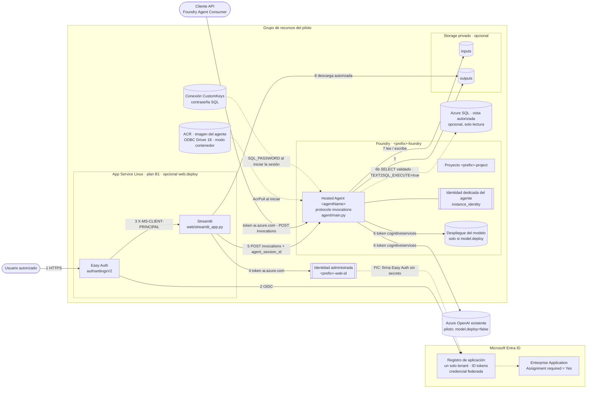

# Arquitectura

## Diagrama

## Componentes

| Componente | Archivos | Responsabilidad |
| --- | --- | --- |
| Lógica del agente | `agent/text2sql_core.py` | Text-to-SQL original (copia literal): prompt, validación AST, ejecución de solo lectura y `RespuestaAgente`. |
| Puente | `agent/starter_agent/handler.py`, `agent/text2sql_adapter/` | `handle_message` delega en `bridge.answer`: estado, errores del contrato, `resultado.json`, presentación y dobles simulados. |
| Contrato | `agent/starter_agent/contract.py` | Tipos (`AgentContext`, `AgentResult`, `OutputFile`), errores (`AgentInputError`, `AgentBusyError`, `AgentConfigError`), límites y formato JSON `starter.v1`. |
| Servicio | `agent/starter_agent/service.py` | Valida la solicitud, ejecuta el handler, guarda archivos con idempotencia y produce `(status, body)`. Sin HTTP. |
| Adaptador Foundry | `agent/main.py` | `InvocationAgentServerHost` (azure-ai-agentserver-invocations 1.3): `POST /invocations`, `GET /readiness`, cabecera `x-agent-session-id`. Ejecuta el handler en un hilo para no bloquear el bucle async. |
| Adaptador local | `agent/starter_agent/local.py` | Mismo servicio sin red: CLI y modo `inprocess` de la web. |
| Modelo | `agent/starter_agent/model.py` | `ModelSettings` (endpoint, despliegue, audiencia, timeout, tokens) y cliente OpenAI `/openai/v1` con token Entra. No conoce el alojamiento. |
| Archivos | `agent/starter_agent/files.py` | `none`, `local` o `blob`. Salidas en `<request_id>/<nombre>`, escritura única. |
| Interfaz | `web/streamlit_app.py` | Chat, historial por sesión, **Nueva conversación**, indicador de espera, errores comprensibles, reintento manual y descargas. |
| Cliente | `web/client.py` | Transportes Foundry, HTTP local y en proceso; interpretación JSON/SSE; reintentos. |
| Seguridad web | `web/auth.py`, `web/config.py`, `web/files.py` | Identidad Easy Auth, lista de Object IDs, modos explícitos, descarga autorizada. |
| Infraestructura | `infra/main.bicep`, `infra/resources.bicep` | Foundry y proyecto; modelo, ACR, plan, web, identidad, Easy Auth y Storage opcionales; RBAC. |
| Publicación | `azure.yaml`, `scripts/*.ps1`, `scripts/package.py`, `docker/agent.Dockerfile` | Etapas separadas (agente y web por separado); imagen, empaquetado (código o contenedor) y verificación. |

## Identidades

| Identidad | Se crea en | Para qué |
| --- | --- | --- |
| Usuario autorizado | Entra (existente) | Inicia sesión en la página. Debe estar en `allowedUserObjectIds` **y** asignado a la Enterprise Application. |
| Operador / publicador (`publisherObjectId`) | Entra (existente) | Ejecuta Bicep y scripts; publica versiones del agente. |
| `<prefix>-web-id` (asignada por usuario) | `deploy-infra.ps1` | Exclusiva de la web: firma Easy Auth (credencial federada), obtiene tokens para invocar el agente y lee `outputs`. |
| Identidad del agente (`instance_identity`) | Foundry al publicar (`publish-agent.ps1`) | Inferencia del modelo, descarga de la imagen (AcrPull) y acceso a Blob. Dedicada por agente; Bicep no puede referenciarla porque no existe todavía. No se usa para Azure SQL (autenticación SQL; ver CONFIGURATION.md § Secretos). |
| Identidad del proyecto (asignada por el sistema) | `deploy-infra.ps1` | Infraestructura de la plataforma. Recibe Foundry User sobre la cuenta (rol que Learn recomienda para el acceso del proyecto a los modelos) y AcrPull sobre el registro. |
| Registro de aplicación (`authClientId`) | Administrador Entra | Cliente OIDC de Easy Auth. Sin secretos. |

## Permisos

| Quién | Rol | Ámbito | Asignado por |
| --- | --- | --- | --- |
| Identidad del proyecto | Foundry User (antes Azure AI User, `53ca6127-…`) | Cuenta Foundry | Bicep |
| Identidad del proyecto | AcrPull | Registro (si `agentHosting.mode=container`) | Bicep |
| `<prefix>-web-id` | Foundry Agent Consumer | Proyecto | Bicep (si `web.deploy`) |
| `<prefix>-web-id` | Storage Blob Data Reader | Contenedor `outputs` | Bicep (si `web.deploy` y `files.enabled`) |
| Identidad del agente | Cognitive Services OpenAI User | Cuenta Foundry (si `model.deploy`) | `grant-agent-permissions.ps1` |
| Identidad del agente | Cognitive Services OpenAI User | Su Azure OpenAI existente (`MODEL_RESOURCE_ID`) | `grant-agent-permissions.ps1 -ModelResourceId` (vía `publish-agent.ps1`) |
| Identidad del agente | AcrPull | Registro (modo contenedor) | `azd deploy` (según Learn) y comprobado o asignado por `grant-agent-permissions.ps1` |
| Publicador | AcrPush | Registro (modo contenedor) | Bicep (si `publisherObjectId`) |
| Identidad del agente | Storage Blob Data Reader | Contenedor `inputs` | `grant-agent-permissions.ps1` |
| Identidad del agente | Storage Blob Data Contributor | Contenedor `outputs` | `grant-agent-permissions.ps1` |
| Publicador | Foundry Project Manager | Proyecto | Bicep (si `publisherObjectId`) |
| Publicador | Foundry Agent Consumer | Proyecto | Bicep (invocación de prueba) |
| Publicador | Storage Blob Data Contributor | Contenedor `inputs` | Bicep (si `files.grantPublisherInputWrite`) |
| Registro Entra | Credencial federada → `<prefix>-web-id` | Registro de aplicación | `configure-auth.ps1` |

Endurecimiento opcional: `grant-agent-permissions.ps1 -WebConsumerAtAgentScope` concede **Foundry Agent Consumer** a la web solo sobre el agente; después puede retirarse la asignación de proyecto.

No hay claves de Azure:

- Foundry tiene `disableLocalAuth`.
- Storage tiene `allowSharedKeyAccess=false` y `allowBlobPublicAccess=false`.
- El ACR no tiene usuario administrador y tiene `azureADAuthenticationAsArmPolicy` habilitado.
- Easy Auth usa `OVERRIDE_USE_MI_FIC_ASSERTION_CLIENTID` en lugar de un secreto.

El único secreto es la contraseña del usuario SQL. Vive en la conexión CustomKeys del proyecto (Key Vault administrado por Foundry) y la inyecta la plataforma.

Operador: además de los roles anteriores, necesita `roleAssignments/write` en el grupo de recursos y en el Azure OpenAI existente (Owner o Role Based Access Control Administrator), porque Bicep, azd y `grant-agent-permissions.ps1` crean asignaciones.

## Recorrido de una solicitud

1. El navegador abre `https://<prefix>-web.azurewebsites.net`. Easy Auth redirige a Entra; Entra solo emite tokens a usuarios asignados (*Assignment required*).
2. Easy Auth completa el callback (`/.auth/login/aad/callback`, requiere **ID tokens**) firmando la aserción de cliente con la identidad administrada.
3. Cada solicitud llega a Streamlit con `X-MS-CLIENT-PRINCIPAL`. App Service no admite esa cabecera desde el exterior. `web/auth.py` decodifica los claims, exige `tid` = `EXPECTED_TENANT_ID` y `oid` ∈ `ALLOWED_USER_OBJECT_IDS`. Si falla, la página se detiene antes de crear el cliente.
4. Al enviar un mensaje, la web crea un `request_id` y envía `{contract, request_id, message, state}` a `POST {PROJECT_ENDPOINT}/agents/{HOSTED_AGENT_NAME}/endpoint/protocols/invocations?api-version=v1[&agent_session_id=…]` con un token `https://ai.azure.com/.default` de `<prefix>-web-id`.
5. Foundry autoriza el token (esquema `AzureRbac`, rol Foundry Agent Consumer), enruta a la sesión (sandbox) y reenvía el cuerpo al contenedor.
6. `agent/main.py` pasa el cuerpo a `service.process`, que valida y llama a `handle_message`. El puente genera el SQL con el modelo (`STARTER_RESPONDER=model`, identidad del agente), lo valida con el núcleo y, si `TEXT2SQL_EXECUTE=true`, lo ejecuta en Azure SQL con la misma identidad (ver § Integración Text-to-SQL).
7. Si el handler devuelve archivos, se guardan en `outputs/<request_id>/<nombre>` sin sobrescribir.
8. La respuesta `{reply, state, files}` vuelve con `x-agent-session-id`. La web guarda `state` y la sesión en `st.session_state`, y añade los identificadores de archivo a la lista permitida de esa sesión.
9. **Preparar descarga** lee el blob con `<prefix>-web-id` solo si el identificador está en la lista de la sesión. No se generan URL públicas ni SAS.

## Estado y sesiones

- **Estado de la conversación**: lo guarda el cliente y viaja completo en cada turno (máximo 64 KB). Sobrevive a la expiración del sandbox y a nuevas versiones. El agente lo valida como entrada no confiable.
- **Sesión Foundry** (`agent_session_id`): se conserva para reutilizar el sandbox. Se descarta con **Nueva conversación**. Una sesión creada antes de una publicación puede seguir en la versión anterior.
- **Nueva conversación**: acción solo del cliente; borra estado, sesión, historial y lista de archivos.

## Errores, timeouts y reintentos

| Situación | Agente | Web |
| --- | --- | --- |
| Entrada o estado no válido | 400 `invalid_*` | Muestra el mensaje; no reintenta |
| Cuota o timeout del modelo | 503 `busy`/`model_*`, `retryable`, `retry_after_ms` | Reintenta hasta `AGENT_MAX_RETRIES` con espera exponencial y `Retry-After`; después ofrece **Reintentar** |
| Falta configuración o permiso del modelo | 500 `model_config`/`model_forbidden`/`model_not_found` | Muestra el código para el operador |
| Excepción inesperada | 500 `internal_error`, sin detalles | Mensaje genérico; registros solo con metadatos |
| 429 de plataforma `rate_limit_exceeded`, `regional_session_quota_exceeded`, 502/503/504 | — | Reintento automático |
| 429 `session_quota_exceeded` | — | No reintenta: explica que hay que liberar sesiones |
| 401/403/404 de plataforma | — | Mensaje sobre credencial, rol o agente no publicado |
| Timeout de lectura (`AGENT_TIMEOUT_SECONDS`) | — | **No** reintenta solo (el turno pudo completarse); ofrece **Reintentar** con el mismo `request_id` |

**Sin duplicar operaciones**: el reintento reenvía el mismo `request_id` y el mismo estado anterior, así que el turno no se cuenta dos veces; los archivos se escriben una sola vez por `request_id`. El SDK de OpenAI no reintenta (`max_retries=0`) para que no se multipliquen reintentos entre capas. Un handler con efectos externos propios debe usar `context.request_id` como clave de idempotencia.

## Integración Text-to-SQL

### Decisiones

| Tema | Decisión | Motivo |
| --- | --- | --- |
| Lógica de dominio | `agent/text2sql_core.py` es una copia literal (hash en `tests/test_core_copy.py`) | No reescribir ni duplicar la lógica; la carpeta funciona sin el original |
| Punto de extensión | `handler.py` solo delega en `text2sql_adapter.bridge.answer` | El contrato `handle_message` y el `AgentResult` real de la base no cambian |
| Orquestación | `bridge.responder` reproduce las etapas de `responder_pregunta` con generador y ejecutor inyectados | `responder_pregunta` crea su propio cliente con clave y absorbe todos los errores; inyectar permite token Entra y errores reintentables. La paridad se prueba caso a caso |
| Modelo | `context.model` (`starter_agent/model.py`, `/openai/v1` con token Entra, `max_retries=0`) con los mismos mensajes que `generar_sql` | Sin claves en el Hosted Agent; el reintento lo decide la web, una sola vez por capa |
| Conversación | `state` = `{"v":1, "turns", "history"}` con los últimos 10 turnos; no se envía al modelo | Conserva la traducción de una sola pregunta del original y valida el estado como entrada no confiable |
| Resultado completo | `resultado.json` = `RespuestaAgente.to_dict()` por `request_id` | Mismo contrato de datos del original, descargable y escrito una sola vez |
| Presentación | Markdown con SQL en bloque de código y valores escapados (máx. 20 filas) | Un valor de la vista no puede inyectar enlaces, imágenes ni romper la tabla |
| Ejecución | Desactivada por defecto (`TEXT2SQL_EXECUTE=false`) | Igual que `ejecutar=False` del original |
| Simulación | `STARTER_RESPONDER=echo` → generador simulado; `TEXT2SQL_SQL_BACKEND=simulated` → base simulada | Pruebas locales sin modelo ni base; cada respuesta lo indica |
| Publicación | Una sola unidad: `agent/` (base + núcleo + puente) en un ZIP con `remote_build` | Lo pedido; la web es la interfaz de pruebas y se publica aparte |

### Recorrido de un turno Text-to-SQL

1. `service.process` valida la solicitud y llama a `handle_message` → `bridge.answer`.
2. `answer` valida `state`; atiende `/ayuda` y `/historial` sin contar turno.
3. `Configuracion.desde_entorno()` (núcleo) lee `SQL_*`; si falla → `AgentConfigError` `sql_config`.
4. Generador: `context.model.complete([system: construir_prompt(config), user: pregunta])` o el doble simulado.
5. `NO_RESPONDIBLE` → respuesta sin SQL. Si no, `validar_sql` (núcleo) normaliza y limita el TOP; un rechazo es una respuesta con el motivo y el SQL rechazado, nunca se ejecuta.
6. Con `TEXT2SQL_EXECUTE=true`: `ejecutar_sql` (núcleo) revalida, comprueba metadatos reales y lee como máximo `SQL_MAX_ROWS` filas.
7. Se devuelve la respuesta en Markdown, el `state` con el turno añadido y `resultado.json`. Los registros solo contienen `request_id`, etapa, tipo de error y número de filas.

### Errores propios

| Situación | Agente | Web |
| --- | --- | --- |
| Falta `SQL_VIEW_SCHEMA`/`SQL_VIEW_NAME` o motor no admitido | 500 `sql_config` | Muestra el mensaje para el operador |
| `TEXT2SQL_*` no válida | 500 `text2sql_config` | Ídem |
| `NO_RESPONDIBLE`, SQL rechazado, columna ausente en la vista real, error BD no transitorio | 200 con explicación (mensajes del núcleo, sin detalles de BD) | Se muestra como respuesta |
| Cuota/timeout del modelo | 503 `model_*` reintentable | Reintento automático y después **Reintentar** |
| Timeout o comunicación BD (`pyodbc.OperationalError`) | 503 `sql_unavailable` reintentable | Ídem; la lectura validada no tiene efectos |
| Estado manipulado / comando desconocido | 400 `invalid_state` / `unknown_command` | No reintenta |

### Permisos en Azure SQL (fuera de RBAC, no automatizados)

| Quién | Permiso | Ámbito | Cómo |
| --- | --- | --- | --- |
| Usuario SQL de `agent.env` (el mismo que en local) | `SELECT` solo sobre la vista | Base Azure SQL | Ya existe para el uso local; conviene que el DBA confirme que no tiene roles amplios |
| Salida del Hosted Agent | Regla de red | Servidor Azure SQL | «Allow Azure services and resources» o red privada: decisión pendiente (§ Etapa 2) |

`grant-agent-permissions.ps1` no concede permisos en Azure SQL: los permisos de base de datos no son RBAC de Azure.

## Extensiones (no forman parte del piloto)

### Ambientes dev/prod

- Un archivo de parámetros por ambiente (`dev.bicepparam`, `prod.bicepparam`) con prefijos y grupos de recursos distintos; `Get-DeploymentName` ya separa por prefijo.
- Sustituir `allowedUserObjectIds` por un grupo: asigne el grupo a la Enterprise Application y compruebe la pertenencia en la web. Con Graph `checkMemberGroups` se requiere conceder a la identidad de la web `User.ReadBasic.All` y `GroupMember.Read.All` (permisos de aplicación). Alternativa sin Graph: *group claims* en el token y lectura del claim `groups`.
- Si el canal final no es Streamlit, omita la web y conserve el agente.

### Red privada

- Foundry: `publicNetworkAccess: 'Disabled'`, `networkAcls.defaultAction: 'Deny'` y `networkInjections` con una subred delegada para agentes.
- Endpoints privados y zonas DNS para Foundry, OpenAI y Blob; App Service con integración VNet y `vnetRouteAllEnabled`.
- Los scripts de publicación deben ejecutarse desde un runner con acceso a esa red. Vigile `subnet_exhausted` (429) en sesiones.

### SharePoint

- Sustituya `BlobFileStore` por un almacén que use Microsoft Graph con la identidad del agente y `Sites.Selected` más concesión por sitio (`read` en origen, `write` en salida). No conceda `Sites.Read.All`.
- Mantenga la descarga autorizada: o bien la web lee el archivo con su identidad, o bien devuelve un enlace que solo funcione para usuarios con permiso en el sitio.

### Teams / Microsoft 365

- Hosted Agents admite el protocolo `activity` con el esquema `BotServiceRbac`, configurado por el flujo de publicación a Microsoft 365. `handle_message` puede reutilizarse desde un adaptador de actividad; el estado debería guardarse en servidor (por conversación) porque el canal no lo reenvía.
- Requiere aprobación del administrador de Teams y limitar la disponibilidad de la app al grupo piloto.

## Verificación en Azure (pendiente)

No se creó ni modificó ningún recurso durante la extracción ni durante la preparación local. Queda por comprobar con una suscripción real.

### Etapa 2: publicación en un grupo de recursos nuevo

Datos que faltan (todos del destino, ninguno se reutiliza del proyecto de referencia):

| Dato | Dónde |
| --- | --- |
| `subscriptionId`, `tenantId` (el de su Azure OpenAI y su Azure SQL), `resourceGroupName`, `location` (con Hosted Agents) | `infra/parameters/pilot.bicepparam` |
| `prefix` libre, `agentHosting.registryName` y `files.storageAccountName` (nombres globales) | ídem |
| `publisherObjectId` | ídem |
| `MODEL_RESOURCE_ID` de su Azure OpenAI existente (endpoint y despliegue ya están en `agent.env`) | `agent.env` |
| Solo para la web: `authClientId` (registro Entra de un tenant) y `allowedUserObjectIds` con `web.deploy: true` | `pilot.bicepparam` |
| Herramientas: azd ≥ 1.27.1, `azure.ai.agents` ≥ 1.0.0-beta.8, `azure.ai.projects` ≥ 1.0.0-beta.4 (no están instalados en el equipo de preparación) y Docker Desktop (sí está) | Equipo del operador |

Decisiones cerradas en esta etapa:

| Decisión | Configuración |
| --- | --- |
| Modelo | Su Azure OpenAI y despliegue existentes (`model.deploy: false`); no se crea otro |
| Alojamiento | Contenedor (`agentHosting.mode: container`): ACR Basic solo Entra, imagen `docker/agent.Dockerfile` probada en local, subida y fijada por digest (`build-agent-image.ps1 -Push`) |
| SQL | Autenticación SQL existente; contraseña en la conexión CustomKeys `sql-credentials`; Driver 18 en el contenedor y 17 en local |
| Web | Separada (`web.deploy: false`); se añade después sin tocar el agente |
| Trazas | `httpx` añadido: la instrumentación OpenAI carga en la imagen |

Decisiones abiertas:

- **Red de Azure SQL hacia el Hosted Agent**. Learn no documenta IP de salida fijas. Hay dos opciones:
  - **«Allow Azure services and resources»**: rápida, pero admite el tráfico de cualquier suscripción de Azure.
  - **Red privada**: `network.agentSubnet` en el proyecto y Private Endpoint de Azure SQL. Exige Foundry con red privada y ACR Premium o accesible, y en ese caso Learn indica que no se admite el ACR creado automáticamente.

  Lo mismo aplica a su Azure OpenAI si restringe la red.
- **Discrepancia en Learn sobre el ACR**. La página del ACR privado dice que azd concede **AcrPull a la identidad del agente**. Las de permisos hablan de **Container Registry Repository Reader** (o AcrPull) para la **identidad del proyecto**. Se cubren ambas: Bicep asigna al proyecto, y azd y `grant-agent-permissions.ps1` asignan al agente.
- **Identidad administrada para SQL** (sin contraseña): requiere un cambio de código (CONFIGURATION.md § Secretos).
- **App Insights**: opcional; el piloto de referencia tampoco lo tiene.

Comprobaciones posteriores (README § Publicación, comprobaciones 1–5):

1. `preview-infra.ps1`: `what-if`, proveedores (incluido `Microsoft.ContainerRegistry`) y disponibilidad de los nombres del ACR y de Storage. Con `model.deploy=false` se omiten catálogo y cuota.
2. `deploy-infra.ps1`: Foundry, proyecto, ACR con `azureADAuthenticationAsArmPolicy`, Storage y RBAC (sin modelo ni web).
3. `set-sql-secret.ps1`: creación de la conexión CustomKeys con `api-version=2025-04-01-preview`.
4. `build-agent-image.ps1 -Push`: `az acr login` sin usuario administrador, push y digest.
5. `publish-agent.ps1`: comprobar que la extensión instalada acepta `image:` sin `codeConfiguration` y `type: Entra`, que azd no crea otro ACR con `AZURE_CONTAINER_REGISTRY_*`, que concede AcrPull a la identidad del agente, que la versión pasa a `active` y la forma de `versions.latest`.
6. `grant-agent-permissions.ps1 -CheckOnly`: Cognitive Services OpenAI User en `MODEL_RESOURCE_ID`, AcrPull y Blob. Comprobar también si la identidad del agente necesita Foundry User en el proyecto: el piloto de referencia lo asigna, y Learn indica que la inferencia por el proyecto viene incluida.
7. `check-availability.ps1 -InvokeAgent -Message ...`: HTTP 200 por la API, SQL ejecutado (la contraseña se resolvió y la red funciona) y respuesta JSON o SSE.
8. Web, cuando se active: `configure-auth.ps1`, `publish-web.ps1` (Oryx con Python 3.13) y el inicio de sesión manual con un usuario autorizado y otro rechazado.
